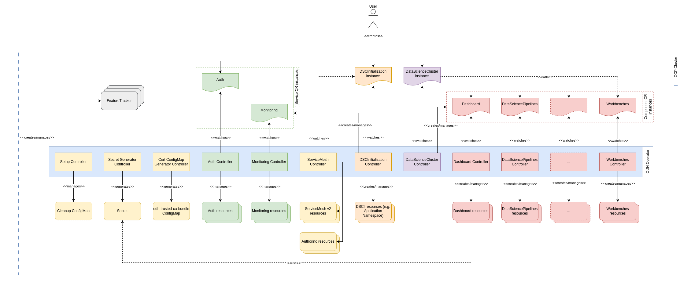

# Open Data Hub Operator Design

The following document outlines the current design of the Open Data Hub operator and the resources it manages.
It covers in-tree component reconciliation and the PlatformModule architecture for out-of-tree module operators.

## Motivation

The current ODH operator design adheres to the following general goals:

- Create an opinionated deployment of ODH components.
- Provide the ability to enable/disable individual components.
- Provide users and cluster administrators with the ability to customize components.
- Provide the ability to reconcile individual ODH components using dedicated component controllers, instead of relying on a single controller/reconcile loop for everything.
  - improve scalability, separation of concerns/modularity, and error handling/failure isolation.
- Improve operator performance.
  - utilize proper caching mechanisms, parallelism and by avoiding bottlenecks.
- Provide the ability to easily clean up the cluster in a non-destructive way after ODH uninstallation.
- Improve visibility of the ODH platform state.
  - adopt status conditions.
  - improve logging and troubleshooting and debugging capabilities for ODH deployments.
- Provide support for configuring auth and monitoring at the ODH platform level.
- Provide support for easier integration of future ODH components and services.

## Custom Resources managed by the ODH operator

To deploy ODH components seamlessly, the ODH operator watches two [user-facing custom resources (CRs)](#user-facing-custom-resources-and-their-controllers) - **DSCInitialization** and **DataScienceCluster** – which are together responsible for ODH configuration and component setup.

In addition, each ODH component is represented by its own dedicated API/custom resource.
In-tree component CRs and their subresources are managed by dedicated component controllers. Out-of-tree module CRs are reconciled by separate module operators, whose deployment is managed through PlatformModule trackers.
More details on the supported ODH components are provided [here](#component-crs-and-controllers).

The [Platform and PlatformModule controllers](#platform-and-platformmodule-controllers) coordinate module operator deployment and report platform readiness.

Furthermore, there are dedicated [service CRs and controllers](#service-crs-and-controllers) for configuring authentication and monitoring.

Lastly, the ODH operator also manages [accessory controllers](#accessory-controllers) responsible for helper tasks, such as cleanup after uninstallation.

The original in-tree component reconciliation layout is shown below. The PlatformModule controller responsibilities are described in the next section.



### User-facing Custom Resources and their controllers

On OpenShift, the user-facing CRs are **DSCInitialization** (DSCI) and **DataScienceCluster** (DSC), along with **Auth** CR.
Together, these CRs are responsible for configuration of ODH at the platform level.
Standalone xKS deployments use the **Platform** CR for shared configuration and module enablement, and users create module CRs directly.

#### DSCInitialization (DSCI)

- DSCI CR is managed by the ODH operator to perform initial setup that is common for all components.
  - for example, DSCI defines the namespace for ODH component deployments, monitoring config,...
- Some examples of initial setup include creating namespaces, network policies, common configmaps and secrets.
- DSCI instance is a singleton in the cluster, i.e., only one instance of this CR can be present in the cluster.
- DSCI controller implementation can be found in `internal/controller/dscinitialization` directory.

#### DataScienceCluster (DSC)

- DSC CR is watched by the ODH operator and serves as a single point to configure and enable various ODH components.
- It is responsible for enabling support for CRDs like Dashboard, Workbenches, DataSciencePipelines, etc.
- Like with DSCI, DSC instance is also a singleton in the cluster. A user can update the CR to enable/disable components.
- DSC controller implementation can be found in `internal/controller/datasciencecluster` directory.
- Detailed API fields are described in the CRD. Example DSC configurations are provided in the [Examples section](#examples).

#### Auth

- described in [Service CRs section](#service-crs-and-controllers).

### Platform and PlatformModule controllers

The `config.opendatahub.io/v1alpha2` Platform CR holds shared configuration and module management states. On OpenShift, DSC/DSCI controllers project module enablement into Platform and create or delete their module CRs with the full component configuration.

| Controller | Resources and responsibilities |
|------------|--------------------------------|
| Platform (`internal/controller/modules/`) | Owns one `config.opendatahub.io/v1alpha2` PlatformModule tracker per managed module, coordinates the unified component/module DAG, persists deployment checkpoints in `status.dag`, and aggregates tracker readiness. |
| PlatformModule (`internal/controller/platformmodules/`) | Renders and deploys the module operator's Helm charts or Kustomize manifests, owns removable operator resources, watches module CR readiness, and commits the successful resource inventory and release to tracker status. |
| DSC/DSCI | Own module CRs and project module status into the DSC/DSCI API. |
| Out-of-tree module operator | Reconciles its module CR and owns the component workloads. |

Disabling a module deletes its owned tracker. DSC/DSCI request module CR deletion on OpenShift; users or GitOps do so on xKS. The tracker finalizer keeps the operator available until the module CR is absent: when the module CR is already deleting, cleanup waits until it is gone. If the owning Platform re-enables the module while the old tracker is terminating, the finalizer instead cleans up that tracker's operator resources while the module CR is still live, so the replacement tracker can deploy. Platform explicitly waits for its tracker finalizers and reports pending removal in readiness. Inventory cleanup preserves CRDs, Namespaces, Leases, and externally owned resources. Each tracker commits its inventory and release only after operator resource apply and tracker-owned cleanup complete. Runtime readiness continues to follow module CR status.

See [PlatformModule ownership and cleanup](../internal/controller/modules/README.md#ownership-and-cleanup) for inventory and finalization, and the [module integration guide](../internal/controller/modules/README.md) for handler implementation.

### Component CRs and controllers

The ODH operator reconciliation refactor introduced dedicated CRDs for each ODH component.
For in-tree components, each enabled component has a dedicated singleton CR and owned subresources managed by a component controller under `internal/controller/components/`. Component CRs are owned by the DSC.

For out-of-tree modules, DSC/DSCI retain ownership of the module CR, while the PlatformModule controller manages its operator deployment. The active module registrations and runlevels are defined in `internal/controller/modules/builtin/handlers.go`.

Component and module handler registries hold handlers and startup enablement.
The unified provisioning registry owns runlevels, readiness gating, and reverse
cleanup ordering; handler enumeration is alphabetical.
 
Examples of component CRs (including modules reconciled by out-of-tree operators):

| **ODH Component** | **CR Kind** |
| --- | --- |
| ODH Dashboard | `Dashboard` |
| Data Science Pipelines | `DataSciencePipelines` |
| Feature Store (Feast) | `FeastOperator` |
| KServe | `Kserve` |
| Kueue | `Kueue` |
| AI Hub | `AIHub` |
| Ray | `Ray` |
| TrustyAI | `TrustyAI` |
| Workbenches (IDEs) | `Workbenches` |


Component reconciliation refactor introduced a generic component reconciler builder and a CLI tool for generating the necessary files, making it easier to integrate new components in the future.
For more details, please refer to the [Component integration guide](https://github.com/opendatahub-io/opendatahub-operator/blob/main/docs/COMPONENT_INTEGRATION.md).

### Service CRs and controllers

In addition to the previously-mentioned CRs and their controller, the operator also manages the following ODH service CRs:
- `Auth`
  - user-facing CR
  - responsible for auth configuration
  - singleton instance in the cluster
  - controller implementation located in `internal/controller/services/auth` 
- `Monitoring`
  - responsible for monitoring configuration
  - singleton instance in the cluster
  - controller implementation located in `internal/controller/services/monitoring`

### Accessory controllers

The ODH operator currently manages several accessory controllers that handle parts of its functionality.
The currently used accessory controllers are listed below:
- Cert ConfigMap Generator controller
  - responsible for generating the ConfigMap with certificates (`odh-trusted-ca-bundle`), which includes cluster-wide trusted-ca bundle and custom ca bundle in every new namespace created.
  - controller implementation located in `internal/controller/services/certconfigmapgenerator`.
- Setup controller
  - responsible for managing the ConfigMap that triggers the cleanup/uninstallation of ODH.
  - handles the cleanup logic itself.
  - controller implementation located in `internal/controller/services/setup`.

## Trusted CA Bundle

The ODH operator provides a mechanism for configuring custom CA certificates that components can use to trust self-signed or enterprise Certificate Authorities. This is particularly useful for features like external OIDC authentication where the identity provider may use a custom CA.

### How it works

1. **User Configuration**: Administrators configure custom CA certificates in the `DSCInitialization` CR:

```yaml
apiVersion: dscinitialization.opendatahub.io/v2
kind: DSCInitialization
metadata:
  name: default-dsci
spec:
  trustedCABundle:
    managementState: Managed
    customCABundle: |
      -----BEGIN CERTIFICATE-----
      MIIDXTCCAkWgAwIBAgIJAKZ... (your CA certificate)
      -----END CERTIFICATE-----
```

2. **ConfigMap Generation**: The Cert ConfigMap Generator controller watches the DSCI and creates an `odh-trusted-ca-bundle` ConfigMap in every active, non-reserved namespace. This ConfigMap contains:
   - The cluster-wide trusted CA bundle (from OpenShift's `openshift-config/user-ca-bundle` if present)
   - The custom CA bundle from `DSCInitialization.spec.trustedCABundle.customCABundle`

3. **Component Integration**: Components that need to trust custom CAs can mount this ConfigMap. The operator does **not** automatically configure all components - each component or external dependency must be configured manually.

### Example: Configuring Authorino for External OIDC

When using external OIDC authentication with a custom CA (e.g., self-signed Keycloak), you must manually configure the Authorino CR to mount the CA bundle:

```yaml
apiVersion: operator.authorino.kuadrant.io/v1beta1
kind: Authorino
metadata:
  name: authorino
  namespace: kuadrant-system
spec:
  volumes:
    items:
    - name: odh-trusted-ca-bundle
      mountPath: /etc/ssl/certs/odh-trusted-ca-bundle
      configMaps:
      - odh-trusted-ca-bundle
```

The `odh-trusted-ca-bundle` ConfigMap will be available in the `kuadrant-system` namespace (and all other active, non-reserved namespaces) automatically once DSCI's `trustedCABundle` is configured.

### Important Notes

- The `odh-trusted-ca-bundle` ConfigMap is automatically created in **all active, non-reserved namespaces** by the certconfigmapgenerator controller
- Components and external operators (like Authorino) must be **manually configured** to mount and use this ConfigMap
- The operator does not automatically modify external CRs (e.g., Authorino, Istio) to use the CA bundle
- If `trustedCABundle.managementState` is set to `Removed`, the ConfigMaps will be deleted from all active, non-reserved namespaces

## Examples

1. Enable all components in DataScienceCluster

```console
apiVersion: datasciencecluster.opendatahub.io/v1
kind: DataScienceCluster
metadata:
  name: example
spec:
  components:
    dashboard:
      managementState: Managed
    datasciencepipelines:
      managementState: Managed
    kserve:
      nim:
        managementState: Managed
      rawDeploymentServiceConfig: Headless
    modelregistry:
      managementState: Managed
      registriesNamespace: "odh-model-registries"
    ray:
      managementState: Managed
    kueue:
      managementState: Managed
    workbenches:
      managementState: Managed
    trustyai:
      managementState: Managed
    feastoperator:
      managementState: Managed
    llamastackoperator:
      managementState: Removed
    ogx:
      managementState: Removed
    mlflowoperator:
      managementState: Removed
    sparkoperator:
      managementState: Managed
```

2. Enable only Dashboard and Workbenches(Jupyter Notebooks) in DataScienceCluster

```console
apiVersion: datasciencecluster.opendatahub.io/v1
kind: DataScienceCluster
metadata:
  name: example
spec:
  components:
    dashboard:
      managementState: Managed
    workbenches:
      managementState: Managed
```
